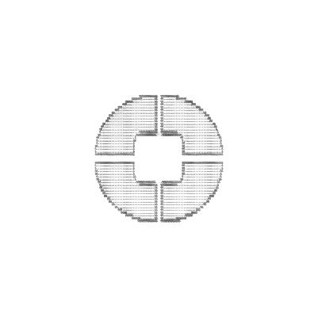
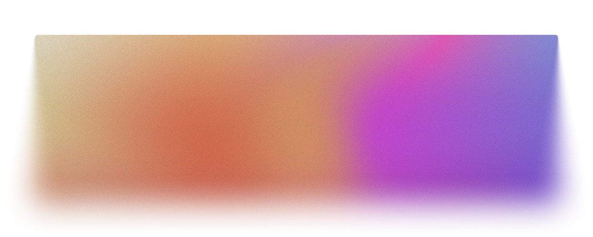

# Omnish



Welcome to **Omnish**! This project is built with [Astro](https://astro.build/) and features a modern, interactive CLI-inspired web experience.

## 🖼️ Mockups & Visuals

| CLI Demo Glow | ASCII Logo | Omnish Icon | Animated Grain |
|:-------------:|:----------:|:-----------:|:--------------:|
|  |  |  |  |

## 🚀 Project Structure

Your project includes the following folders and files:

```text
/
├── public/
│   ├── asciilogo.png
│   ├── cliglow.png
│   ├── omniascii.png
│   ├── selfgrain.gif
│   └── favicon.svg
├── src/
│   ├── assets/
│   ├── components/
│   ├── layouts/
│   ├── lib/
│   ├── pages/
│   ├── stores/
│   └── styles/
└── package.json
```

## 🧞 Commands

All commands are run from the root of the project:

| Command                   | Action                                           |
| :------------------------ | :----------------------------------------------- |
| `npm install`             | Installs dependencies                            |
| `npm run dev`             | Starts local dev server at `localhost:4321`      |
| `npm run build`           | Build your production site to `./dist/`          |
| `npm run preview`         | Preview your build locally, before deploying     |
| `npm run astro ...`       | Run CLI commands like `astro add`, `astro check` |
| `npm run astro -- --help` | Get help using the Astro CLI                     |

## 👀 Want to learn more?

- [Astro Documentation](https://docs.astro.build)
- [Omnish Project Wiki](#) <!-- Add your wiki or docs link here -->
- [Join our Discord](https://astro.build/chat)
